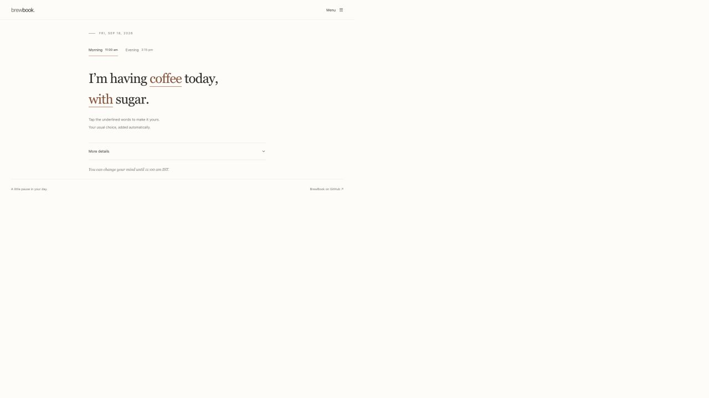
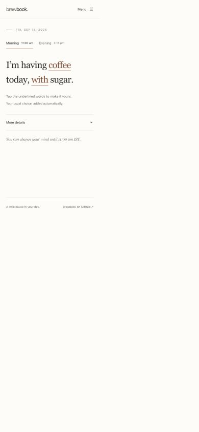

# A quieter daily drink order

The visual and interaction reference is [WhereTo.food](https://whereto.food/): an editable sentence, serif typography, underlined choices, thin rules, and generous space. BrewBook keeps its own identity, drink choices, and office ordering rules.

## Decisions

- Start with “I’m having coffee today, with sugar.” The drink opens a keyboard-accessible selector; with/without toggles directly. No drink removes the sugar control.
- Show one round at a time. Morning and evening remain visible, with the next open round selected on entry. Deadlines are explicitly labelled in IST.
- Put attendance, cutoff details, and team responses inside a native More details disclosure. Attendance is set separately for each round, including half days. Away users see their attendance instead of editable drink controls.
- Move preferences, history, statistics, administration, and sign-out to a labelled menu. Guests get only the navigation appropriate to their session, including a way to leave.
- Remove the sidebar, bottom navigation, repeated poll cards, per-choice counts, decorative illustrations, and surprise logo/name/avatar interactions from the primary flow. Compact default selectors replace repeated drink-option grids.
- Use real serif type with system sans-serif labels, a warm neutral surface, and one brown accent. Keep saved theme preferences and system dark-mode support. No font downloads or new dependencies.
- Save choices immediately, with an announced saving/saved/error state. Wait for server confirmation before changing the displayed value. Serialize daily writes and discard stale background poll results to prevent older reads overwriting a change.

## Accessibility

Primary controls are at least 44px tall. Underlines and text identify the editable values without relying only on color. Radix selectors provide keyboard navigation, typeahead, and Escape; the menu and response dialog trap focus and return it on dismissal. Navigation moves focus into the new main region. There is a skip link, visible keyboard focus, a native details disclosure, and reduced-motion support.

Light-mode body text and accent text exceed 4.5:1 contrast against the page. Small accent links use a lighter color in dark mode. Closed rounds disable edits and explain the deadline; away states explain why no order will be placed.

## Verification

- Production `pnpm build`: passed.
- Biome check of the seven changed TSX files: passed.
- `git diff --check`: passed.
- TypeScript: the same nine pre-existing errors occur on the unchanged base commit and this branch. They are in `scripts/send-push.ts`, `src/components/ui/switch-field.tsx`, `src/lib/drinks.ts`, `src/routes/api/admin.ts`, and `src/routes/api/cooks.ts`; no additional application diagnostics were introduced.
- Browser checks at 1280px, 390px, and 320px: sentence layout, selector keyboard/typeahead behavior, sugar changes, persisted mock values after reload, no-drink state, attendance, closed rounds, guest navigation, menu focus trapping, response-dialog Escape/focus return, compact preferences, sign-in, and failed-save feedback. No horizontal overflow at 320px.

Browser checks used the real application components with a fixed clock and local mocked auth/API responses. Screenshots below contain fictional test data. Live OAuth, PostgreSQL persistence, and production guest approval were not exercised. No production orders or guest requests were created.

## Screenshots

